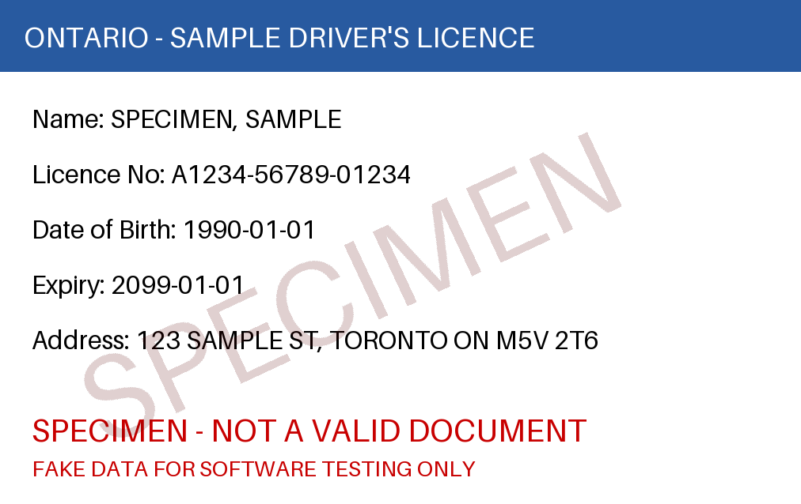

# Canadian ID OCR Tool

Extracts name, date of birth, licence/ID number, address, expiry date and issuing
province from photos of Canadian driver's licences and provincial ID cards.

## Install
1. Install the [Tesseract](https://github.com/tesseract-ocr/tesseract) binary (e.g. `apt install tesseract-ocr`).
2. `pip install -r requirements.txt`

## Usage
- GUI (file picker, then save a PDF report): `python main.py`
- CLI: `python main.py front.jpg -o report.pdf`
- Front + back: `python main.py front.jpg --back back.jpg -o report.pdf`
- Batch: `python main.py ./scans/ https://example.com/id.png -o report.pdf`

## Layout
- `main.py` – entry point, GUI and CLI
- `ocr_processor.py` – loading/downloading images, preprocessing, OCR
- `data_extractor.py` – field parsing and validation
- `pdf_generator.py` – PDF reports
- `config.py` – constants, province data, logging
- `tests/` – run with `python -m pytest`

Supported formats: PNG, JPG, BMP, TIFF, WEBP. Logs go to the console and `id_ocr.log`.
OCR output is imperfect: review extracted values and warnings. Handle ID images as sensitive personal data.

## Downloading and adjusting images
URLs are downloaded automatically. Use `--save-images DIR` to keep the downloaded (and adjusted) image, and
`--rotate DEG`, `--crop L T R B`, `--brightness X`, `--contrast X` to improve scan quality before OCR, e.g.
`python main.py https://example.com/id.jpg --rotate 90 --contrast 1.4 --save-images ./imgs`.
These adjustments only help OCR read the image; the tool does not alter ID content.

## Specimen cards and field review
- `python main.py --make-specimen sample.png` writes a fake test card. It is always stamped "SPECIMEN" (diagonal stamp
  and text in the empty areas); the marking cannot be disabled.
- `--review` (and the GUI) opens a window to correct extracted fields before the PDF is generated.



## Image2PSD web app (PSD Forge)

This repository also contains a separate, standalone web tool that converts
images (PNG, JPG, GIF, WebP, BMP) into layered Photoshop PSD files. It runs
entirely in the browser — no uploads, no dependencies, no build step:

- `index.html` / `styles.css` – the UI
- `script.js` – loading, preview, auto-correction options, export
- `psd-encoder.js` – dependency-free PSD v1 writer (8-bit RGB/RGBA, PackBits RLE)

### Run locally
Serve the repo root with any static server, e.g. `python -m http.server`,
then open `http://localhost:8000/` (opening `index.html` directly also works).

### Deploy to Cloudflare Pages
The repo includes `wrangler.toml` and `.assetsignore` (which excludes the
Python OCR tool files from the deployment), so this works as-is:

```
npx wrangler pages deploy . --project-name psd-forge
```
